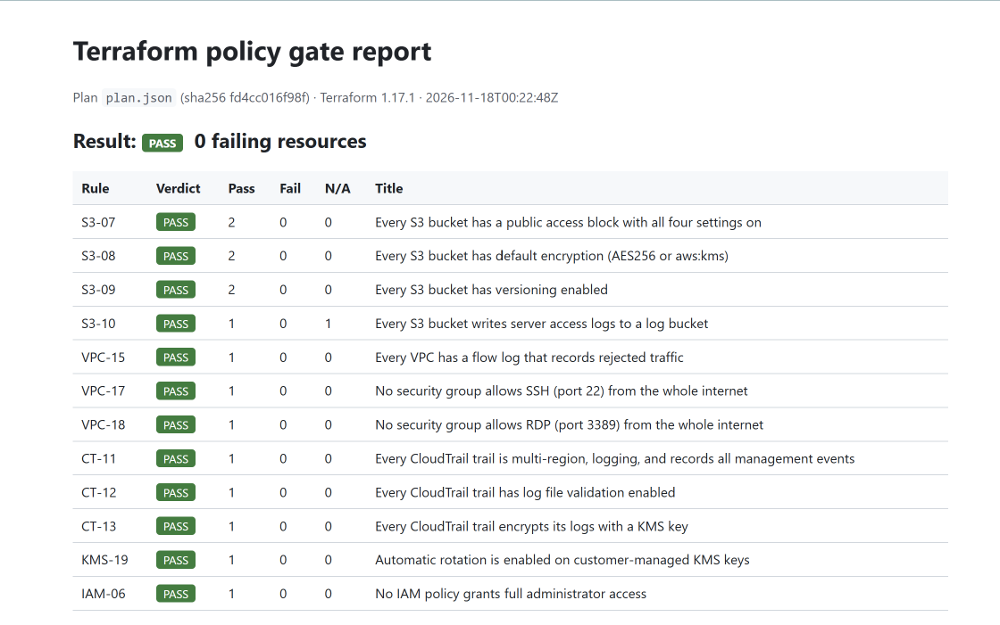
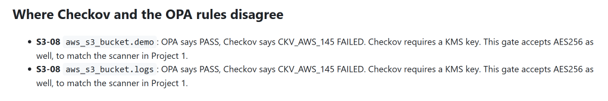

# terraform-policy-gate






A GitHub Actions gate that checks Terraform code for AWS **before** it is deployed. It reads the
Terraform plan, judges it against 12 controls from the **CIS AWS Foundations Benchmark v7.1.0** with
custom OPA/Rego rules, and writes one structured evidence record per resource. Checkov runs next to it
as a second opinion, and the report lists every place where the two disagree. Every rule is mapped to
NIST 800-53 Rev 5, ISO/IEC 27001:2022 and SOC 2.

It is the other half of [aws-cis-scanner](https://github.com/AryanBhosale23/aws-cis-scanner), which audits
an account **after** things are deployed. Same 12 control IDs, same evidence format, same mapping.

**Scenario:** you are the compliance engineer at a 50-person SaaS company preparing for a SOC 2 and ISO 27001
audit. Developers open pull requests with Terraform. Finding an open SSH port in production, months later, is
too late. This blocks the pull request instead, and keeps dated evidence that every change was checked.

## Quick start

```powershell
python -m venv .venv
.venv\Scripts\Activate.ps1          # macOS/Linux: source .venv/bin/activate
pip install -r requirements-dev.txt
winget install open-policy-agent.opa    # OPA; or see https://www.openpolicyagent.org/docs/#running-opa
winget install Hashicorp.Terraform

opa test policies -v                     # the rule tests: no Terraform, no AWS account
pytest -q; ruff check .                  # the Python script tests and lint

cd terraform\insecure
terraform init
terraform plan -out=tfplan               # never run `terraform apply`
cmd /c "terraform show -json tfplan > plan.json"   # cmd avoids PowerShell's UTF-16 output
cd ..\..
python scripts\policy_gate.py --plan terraform\insecure\plan.json --checkov
```

The example folders use fake AWS keys and three `skip_*` settings in the provider block, so
`terraform plan` runs **without an AWS account**. Nothing is ever created. The keys are fake on purpose
(`fake-access-key`), so a secret scanner may flag them; they unlock nothing.

Options: `--output evidence` (default), `--only S3-07` (repeat for more rules), `--checkov` (second
opinion), `--checkov-target terraform\secure` (give Checkov the `.tf` folder instead of the plan).
Each run writes `evidence/<UTC time>/` with one JSON file per rule, `summary.json`, `report.md` and
`report.html`. The exit code is 1 when anything fails, so a pipeline stops.

## What it checks

| Area | Rules | What the gate judges |
|------|-------|----------------------|
| S3 (4) | S3-07 to S3-10 | public access block with all four settings on, default encryption, versioning enabled, access logging |
| VPC (3) | VPC-15, VPC-17, VPC-18 | flow log that records rejected traffic, no SSH or RDP open to `0.0.0.0/0` or `::/0` |
| CloudTrail (3) | CT-11 to CT-13 | multi-region trail that is logging all management events, log file validation, KMS encryption |
| KMS (1) | KMS-19 | automatic rotation on customer-managed keys |
| IAM (1) | IAM-06 | no policy that allows every action on every resource |

The full table, with the CIS number, NIST, ISO and SOC 2 reference, **the reason each mapping holds** and
**where this project differs from the scanner in Project 1**, is in [docs/mapping.md](docs/mapping.md).
The mapping is a judgment, not an official crosswalk.

## How it decides

1. `terraform show -json` turns the plan into JSON. The gate never reads your `.tf` text, only the plan,
   so it sees the values Terraform will actually use.
2. Each rule is a small Rego file in `policies/`. It produces a `deny` list (what broke the rule) and a
   `scope` list (which resources it judged).
3. `scripts/policy_gate.py` asks OPA for both lists, writes a **PASS** or **FAIL** record per judged
   resource, a **NOT_APPLICABLE** record for resources a rule deliberately skipped (with the reason), and
   an **ERROR** record if a rule could not run. It never turns an error into a pass.
4. With `--checkov`, Checkov checks the same plan with the one check that matches each rule. OPA decides.
   Checkov's verdict is stored on the record, and disagreements go in the report.

## An evidence record

```json
{
  "check_id": "S3-07",
  "title": "Every S3 bucket has a public access block with all four settings on",
  "status": "FAIL",
  "resource": "aws_s3_bucket.demo",
  "resource_type": "aws_s3_bucket",
  "timestamp": "2026-11-17T21:53:48Z",
  "controls": {
    "cis": "CIS AWS Foundations Benchmark v7.1.0, 3.1.4",
    "nist_800_53_r5": "AC-3",
    "iso_27001_2022": "A.8.3",
    "soc2": "CC6.1"
  },
  "evidence": {
    "engine": "opa",
    "policy": "policies/s3_07.rego",
    "problems": ["needs a public access block with all four settings on"],
    "checkov": { "check_id": "CKV2_AWS_6", "result": "FAILED", "relation": "weaker" }
  },
  "remediation": "Add an aws_s3_bucket_public_access_block for the bucket with all four settings set to true.",
  "source": {
    "type": "terraform_plan",
    "plan_file": "plan.json",
    "plan_sha256": "<hash of the plan that was judged>",
    "terraform_version": "<version that made the plan>",
    "region": "us-east-1"
  }
}
```

The `source` block ties every record to the exact plan it came from, so the evidence can be checked later.
Records hold addresses and messages, never attribute values, so they do not leak secrets from a plan.

## The two example folders

- `terraform/insecure/` is built to fail: a bucket with none of its protections, SSH and RDP open to the
  world (written three different ways), a VPC with no flow log, a trail that is single-region with no
  validation and no encryption, a key that never rotates, and an admin-everything policy.
- `terraform/secure/` is built to pass: two buckets (the second receives the access logs) with every
  protection, a VPC with a flow log, a multi-region encrypted trail, a rotating key, a narrow policy, and a
  security group that opens only HTTPS to the world.

The pipeline in `.github/workflows/policy-gate.yml` plans both folders and **asserts** that all 12 rules pass
on the secure one and all 12 fail on the insecure one. A gate that can never fail proves nothing, so the
insecure folder is the proof that it can.

## Design decisions

- **Before deployment, no account needed.** It judges a plan, so it can run on any pull request.
- **"No data" never passes.** A missing value, an unreadable policy, or a value Terraform cannot know until
  apply counts as a failure, never a pass. A rule that crashes is an `ERROR`.
- **OPA decides, Checkov cross-checks.** Where Checkov's equivalent check is weaker or stricter than the
  control, a Rego rule decides. I ran both on the same cases and wrote down what differs
  (see `docs/mapping.md`). Checkov is stricter on S3-08 (it demands KMS); it is weaker on S3-07, VPC-15 and
  CT-11; it does not judge IAM-06 attachments.
- **One record per resource**, so each resource is its own evidence.
- **Honest about exemptions.** A bucket that only receives logs is exempt from S3-10 (otherwise every log
  bucket would need its own log bucket, forever). The exemption is recorded as `NOT_APPLICABLE` with the
  reason, never silently skipped.
- **Tested both ways.** Every rule has tests where a bad plan must be denied and a good plan must be
  allowed. I also checked each rule's tests fail if the rule is replaced by "never deny" or "always deny".
  `opa test`, `opa check --strict`, `ruff` and `pytest` run in CI on every push.

## Limits

- **Root module only.** Resources inside child modules, and resources made with `count` or `for_each`, are
  judged, but the links between a bucket and its companion resources are not followed, so those rules fail
  them (a false FAIL, never a false PASS). Flatten the module or extend the rules.
- **Plan-time only.** It sees what the code declares. It cannot see settings made by hand, drift, or
  resources created outside Terraform, and it cannot judge account-level settings (account-wide S3 Block
  Public Access, the default security group, AWS Config, the IAM password policy). Project 1 covers those.
- **Unknown values fail.** A value that Terraform cannot know until apply is treated as missing. The classic
  case is an IAM policy built from another resource's computed `arn`: the text is unreadable at plan time,
  so IAM-06 flags it. Build the ARN from a known value, such as the bucket name, as the secure example does.
- **CT-11 relies on an AWS default:** a trail with no event selector records all management events.
- **VPC-15 counts only flow logs attached to the VPC itself**, not to a subnet or a network interface.
- **IAM-06 judges `Allow` statements with `*` as the action and `*` as the resource.** It does not judge
  `NotAction`, and it judges an attachment only when the policy ARN is written out in full.
- **VPC-17 and VPC-18 recognise TCP (`tcp`, `TCP`, `6`) and all-protocol (`-1`) rules.**
- The NIST, ISO and SOC 2 columns are my mapping, an evidence pointer and not a certification.
  Passing these checks does not make an account secure or an audit pass.
- `plan.json` can hold real values from a real stack. It is git-ignored here. Do not publish plans.

## How to add a rule

1. Write `policies/<id>.rego` (package name = file name). Produce a `deny` set whose messages start with
   `ID: <resource address> ...`, and a `scope` set of the addresses it judged.
2. Write `policies/<id>_test.rego` first: one test that must be denied and one that must be allowed.
   Watch the denied test fail before you write the rule.
3. Add the rule to `scripts/rules.json` (title, mapping, remediation, Checkov check) and a row with the
   reason to `docs/mapping.md`.
4. Add a failing and a passing resource to the two example folders, then run the gate on both plans.

## Ideas for next

Follow links into child modules, `count` and `for_each` support, the remaining CIS recommendations, a diff
between two runs, and posting the report as a pull request comment.

## Sources

- CIS Amazon Web Services Foundations Benchmark v7.1.0 (recommendation numbers only; the benchmark
  text is not included, see CIS terms of use)
- NIST SP 800-53 Rev 5
- ISO/IEC 27001:2022, Annex A
- AICPA SOC 2 Trust Services Criteria
- Open Policy Agent documentation; Terraform JSON plan representation; Checkov documentation
